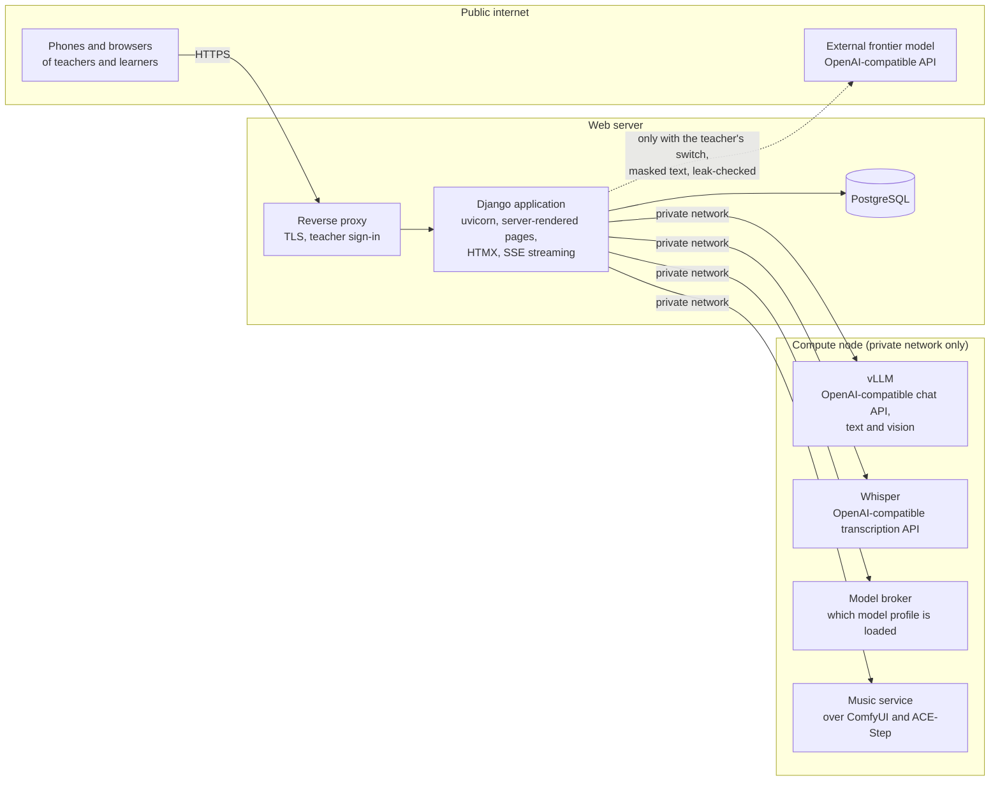
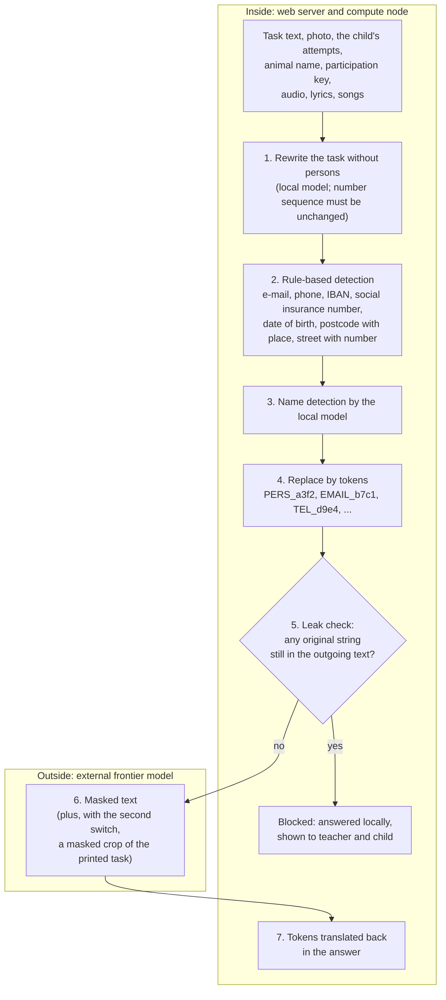
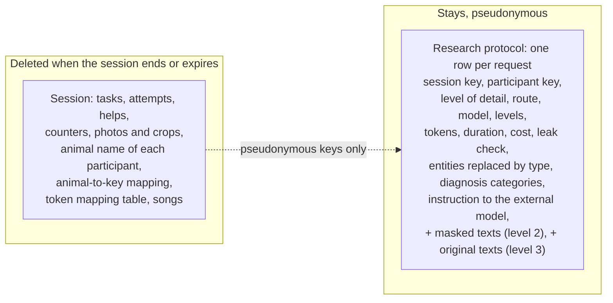

# Architecture

ModLearn Lab runs on two machines. A **web server** is the only machine that
teachers and learners talk to. A separate **compute node** (the project calls
it the "Rechensklave", the model host) runs the language models and is
reachable from the web server only, over a private network. An optional
third party, an **external frontier model**, is reached only for quality
assurance, only when the teacher switches it on for a session, and only
with masked task text.

This document describes the parts, what runs where, the privacy wall
between the three zones, what is logged at which level, and what teachers
and learners see. It contains no addresses, host names or credentials;
every address is configuration (`.env.example`).

Terms used below: *session* is one lesson, opened by a teacher and joined by
a class with a six-digit code; *participant* is one learner in a session,
known to the application only as an animal name; *level* is one of the five
help levels of the mathematics help (motivation, feedback, general
strategy, content strategy, solution).

## 1 Overview

Three rules hold the picture together:

1. **Learners never reach the compute node or the external model.** The
   browser talks to the web server only. Audio for the speaking coach,
   photos of tasks and song lyrics travel to the web server and from there
   to the node; the browser never sees a node address.
2. **The compute node is not on the internet.** The web server reaches it
   over a private network (we use a WireGuard-based overlay network; any
   private link works). There is no API key between web server and node;
   the network boundary is the protection. The two node services that take
   state-changing requests (broker, music) additionally expect a shared
   secret that the application reads from a file mounted read-only, never
   from the environment and never written to a log.
3. **Nothing leaves the two machines unless a teacher switched the
   external path on for this session**, and then only the task text after
   the chain in section 4. The default of every new session is off.

## 2 The compute node

### Hardware

The node can be any DGX Spark-class device. Ours is an ASUS Ascent GX10
(NVIDIA GB10 Grace Blackwell, 128 GB unified memory). The model selection
and the memory layout are tuned to that class of machine: a mixture-of-
experts language model of about 35 B parameters with vision (we run
Qwen3.6-35B-A3B without the thinking phase), a large Whisper model beside
it, and a music generation model that ComfyUI loads into the same memory.
Because the memory is shared, the node runs in **profiles** (language model
plus speech; language model alone; creative models alone), and switching a
profile takes one to four minutes. The broker exists to make that visible.

Nothing in the application depends on the hardware. `SPARK_BASE_URL` and
`SPARK_MODEL` point to **any OpenAI-compatible chat endpoint**: vLLM,
llama.cpp server, Ollama, a hosted API. Photographed tasks need a model that
accepts images in chat messages (`image_url` with a data URL); with a
text-only model, typed and dictated tasks still work. Each optional service
is switched off when its address is empty, and the corresponding button
disappears from the interface instead of failing.

### Services

What runs on the node is described here, not shipped: the compose files,
the broker and the music service are operated separately and are not part
of this repository.

| Service | What it does for the application | Interface |
|---|---|---|
| **vLLM** | Every language-model call: diagnosis of a learner's attempt, the help text, output checks that need a model, transcription of a photographed task, the name detection and the person-free rewrite of the privacy shield, the vision steps of the image chain, the speaking coach, the trainer, the safe chat, song lyrics on request. | OpenAI-compatible `/chat/completions`; JSON schema enforced where the application needs structured answers. |
| **Whisper** | Speech recognition for the speaking coach and for dictated tasks. The browser records short segments (voice activity detection in an AudioWorklet, at most 25 s, 16 kHz WAV), the web server forwards them, the transcript comes back with the model's confidence values, and silence is not a turn. Audio is never stored. | OpenAI-compatible `/audio/transcriptions`. |
| **Model broker** | The one place that knows which profile is loaded. The application asks it for status and, from the booking system, can request a profile switch for a booked slot. Status is cached for ten seconds; the client never raises, a node that is restarting must not take a booking page down with it. | Small HTTP service: health (open), status, models, activate; shared secret in a request header. |
| **Music service** | The music lesson: a child writes lyrics and picks a style, the service renders a song. One worker renders serially, so the application shows queue position and remaining wait. Jobs carry the session's pseudonymous key, so the application can delete all songs of a lesson at once when the session ends; the service also expires files after a few hours by itself. | Small HTTP service: health, styles, limits, submit job, job status, file; same shared secret as the broker. |

### Availability

The node may be away for a minute or two (profile switch, restart). The
application therefore uses a timeout, exactly one retry, and an error text a
child understands instead of a stack trace. An outage never deletes a
running session.

## 3 The web server

- **Stack.** Django 5.2 on Python 3.12, PostgreSQL 16, uvicorn, Docker
  Compose. Pages are rendered on the server; HTMX handles interaction; the
  help text streams to the browser as server-sent events. No JavaScript
  build. The application container listens on the loopback interface only;
  a reverse proxy (we use Caddy) terminates TLS and, for teachers, checks the
  institution's single sign-on and passes the identity to the application
  in headers together with a secret from a read-only file.
- **Three Django apps.** `core` (start page, project page, legal pages,
  sign-in, music test corner), `tutoring` (sessions, participants, tasks,
  help levels, diagnosis, output checks, model client, privacy shield,
  image chain, task pool, teacher views, research protocol), `plan`
  (booking of the compute node, broker client).
- **Five lesson modes**, chosen by the teacher when opening a session:
  mathematics help, trainer (a topic explained in steps with a check),
  speaking coach (English conversation with speech in and out), music
  lesson, and safe chat.
- **Enforced in the server, not requested in the prompt.** A system prompt
  is a request; everything that must hold is a server rule. The maximum
  help level set by the teacher, exactly one level per request, the order
  of the conversation phases in the speaking coach, the deterministic
  output checks (no solution before the last level, no invented quotes, no
  question that only lets the child fill in a number), the budget of the
  external path and the logging level are all decided in code and tested.

## 4 The privacy wall

**What never crosses the wall:** the photo itself, the child's own attempt
(it is masked as an image and was never sent as text), names and other
identifiers, the participation key, the token mapping table, audio, song
lyrics (they go to the node only), and anything at all while the teacher's
switch is off. A social insurance number is not masked but blocks the call
outright.

**What may cross, and only then:** the task text, after the seven steps in
the diagram. Step 1 lets the local model rewrite the task without any
person; the rewrite is accepted only if the sequence of numbers in it is
identical to the original. Steps 2 to 5 run on that rewritten text as a
second net. The call is also blocked when no key is configured, when the
name detection on the node did not run (a masking whose detection failed is
no masking), when the session's or the day's budget is used up (euro limits
from a price table in the configuration, and call counts that work without
prices), or when the leak check finds an original string in the outgoing
text.

**What the answer is used for.** In the mathematics help the external
model's checked solution stays internal: the child never sees it. It
supports the diagnosis, so that an addition where a multiplication was
needed is noticed at the feedback level and not at the end. In the safe
chat the answer is shown, and after each answer the application asks the
external model a second question, whether it saw a reference to a person in
the request, and shows that verdict as a diagnosis, not as a boundary.

**The second switch: a crop of the printed task.** Photos go out only if the
teacher additionally allowed images for the session, and only through the
image chain, which fails closed at every step:

1. Load and re-encode: apply the EXIF orientation, then drop all metadata
   including GPS, convert to RGB, limit the long edge, build a fresh image.
2. Locate: the vision model on the node returns boxes for printed task,
   handwriting, name, face and logo, forced into a JSON schema.
3. Mask, then crop: everything sensitive is painted black with a margin,
   then the image is cropped to the union of the printed task regions.
   Masks win over the crop. Without a printed region the image is blocked.
4. Check with a second net: the model is asked whether handwriting, a name,
   a face or a logo is still visible (a missing key counts as visible), and
   an OCR of the crop is compared deterministically with the application's
   transcript: no rule or name hit of the transcript may be readable, no
   number may appear that is not in the task, at least one number of the
   task must be readable.
5. Re-mask exactly once if a detected name is still readable, then repeat
   step 4 in full. Anything still flagged blocks the image.
6. The crop goes out as a data URL beside the masked text, with a sentence
   saying what it is. The crop dies with the session like the photo.

The wording in the interface is "cropped and cleaned", not "anonymised":
the chain removes what it finds and is measured on test pages, and the
teacher who switches it on sees, for every task, the photo (which stays)
next to the crop that went out, with the masks by type, or the reason why
nothing went out.

## 5 What is logged where

The unit of analysis is the **single request to a language model**, local
or external. Each one is a row in the research protocol with pseudonymous
keys and no foreign key to the session: the protocol survives the end of
the session, the bridge to the people does not.

**Three levels of detail.** The level is a server setting
(`PROTOKOLLSTUFE`); higher levels include the lower ones.

| Level | Rows carry | Intended for |
|---|---|---|
| 1, counts only | time, pseudonymous session and participant key, route (local or external), model, level requested and granted, tokens in and out, duration, cost, leak check passed or blocked, number of replaced entities by type, the diagnosis as categories, the instruction sent to the external model (the application's own text, never a child's). **No content.** | other schools using the software; the default for anyone who deploys it elsewhere |
| 2, masked texts | additionally the complete masked input and output. On the external route that is exactly what the internet saw; on the local route the same masking is applied before storing. | pseudonymous research with the school's information |
| 3, original texts | additionally the original request and the answer as the child saw it. | research on our own server; the texts are anonymised before analysis |

On our server the level is fixed at 3, because web server and compute node
stand in the institution and the lab is used by the institution's own
practice school, like any other school server. Adults who join a level-3
session are asked for consent on the join screen; refusing costs nothing,
they take part and are logged at level 1. Children are not asked; for them
the fixed level applies. `PROTOKOLLSTUFE_WAEHLBAR` brings the choice back
into the teacher's form; `PROTOKOLLSTUFE=1` fixes counts only. Both are
configuration, not code changes.

**What else is written.** The application keeps no access log with
requested addresses, and the reverse proxy in front of it is configured
without one. The server log carries operational messages only (the node
was unreachable, a call was blocked), never content. Costs are computed per
request from a price table in the configuration and summed per session and
per day for the budget guard.

**What a teacher can do with the protocol.** After the session a teacher
opens a timeline of all requests of that session: one line per request
with time, route, levels, duration, tokens, cost and leak check; expanded,
the instruction, the masked outgoing text, the answer, and (at level 3)
what became of it locally. Filters: one route, blocked calls only, one
level, one participant key. The filtered rows export as JSON and CSV. Which
animal made a request cannot be reconstructed, that mapping was deleted
with the session.

## 6 What teachers see and what learners see

### Teachers

- **Opening a session:** mode, subject and school level, the maximum help
  level the tutor may give, the quality-assurance switch and, under it, the
  image switch (both off by default, with an explanation page each), an
  optional expiry after inactivity. The session gets a six-digit code and a
  QR code.
- **The class picture:** one tile per child, sorted by attention need. A
  tile shows the current task, the path through the help levels, the last
  contribution and its diagnosis. Tiles move to the top when a contribution
  does not belong to the task (traffic light orange or red), when the same
  level was given three times, or when a child has been silent for five
  minutes.
- **The full dialogue of a child:** every task, every attempt, every help
  with its level and form, the diagnosis behind each help, the child's
  rating of the help and the estimate of the child's own share of the work.
  When the external path was used: the instruction, the text that went out
  exactly as the internet saw it, the answer, and what became of it locally;
  for images, the photo that stayed next to the crop that went out, or the
  reason it was blocked. In the safe chat and the speaking coach the same
  view with the numbers of the conversation; in the music lesson all songs
  of the class.
- **The task pool:** tasks the teacher puts into a running mathematics
  session, each solved once by the local model and, with the switch on, by
  the external model, with the status (agree, disagree, blocked, unclear)
  and both solutions before the class works on it.
- **The protocol view** of section 5, with export.
- Teacher accounts hold no data of children: a user name, a password hash,
  the sessions with their settings and timestamps.

### Learners

- No account, no name, no e-mail. A child enters the code and picks an
  animal. The animal stays visible on the screen for the whole lesson,
  together with the note that the teacher can read along. A child who tries
  to talk the tutor out of its rules is told openly that this is not the
  point and that the teacher can see it.
- **The chat:** the task (typed, photographed or dictated, or chosen from
  the teacher's pool), the child's own attempts, the help texts one level
  at a time with their level shown, the tutor's question at the end of each
  help, the why-question after a correct result, and the child's own rating.
  The child sees which levels the teacher allowed and never more.
- **In the safe chat:** every step of the outbound path, what went out
  masked, what came back, and the external model's verdict, so that the
  child sees the wall working.
- **Never:** the checked solution from the external model, other children's
  dialogues, the class picture, the protocol, any address of the node.
- **Deletion:** when the teacher ends the session, or when a set expiry
  passes, all tasks, attempts, helps, counters, photos, crops, songs and
  the animal-to-key mapping are deleted. The research protocol of section 5
  is what remains, pseudonymous.

## 7 Configuration

Every setting the application reads from the environment is listed in
`.env.example` with a comment. The ones that define the architecture:

| Setting | Meaning |
|---|---|
| `SPARK_BASE_URL`, `SPARK_MODEL` | the chat endpoint on the compute node (any OpenAI-compatible server) |
| `SPARK_AUDIO_BASE_URL`, `SPARK_AUDIO_MODEL` | speech recognition; empty switches the microphone off |
| `SPARK_BROKER_URL`, `SPARK_BROKER_SECRET_DATEI` | model broker and the file with its secret; without the file the switch button is absent |
| `MUSIK_URL` | music service; shares the broker's secret |
| `CLOUD_BASE_URL`, `CLOUD_MODEL`, `CLOUD_API_KEY`, `CLOUD_PROVIDER` | the external path; the key lives in a separate file outside the project tree, and without key and model the switch is a visible dry run |
| `CLOUD_PREISE`, `BUDGET_JE_SITZUNG_EURO`, `BUDGET_JE_TAG_EURO`, `CLOUD_AUFRUFE_JE_SITZUNG`, `CLOUD_AUFRUFE_JE_TAG` | price table and the budget guard |
| `PROTOKOLLSTUFE`, `PROTOKOLLSTUFE_WAEHLBAR` | level of detail of the research protocol |
| `PH_PROXY_SECRET_DATEI` | the file with the secret shared with the reverse proxy for teacher sign-in |

Secrets are read from files mounted read-only into the container, never
from the repository, never from the environment where a file is possible,
and never written to a log or an error message.
